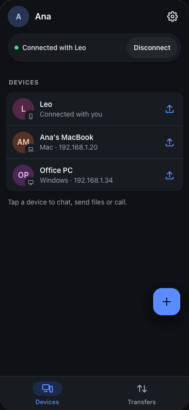
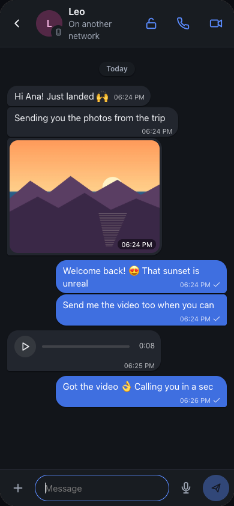
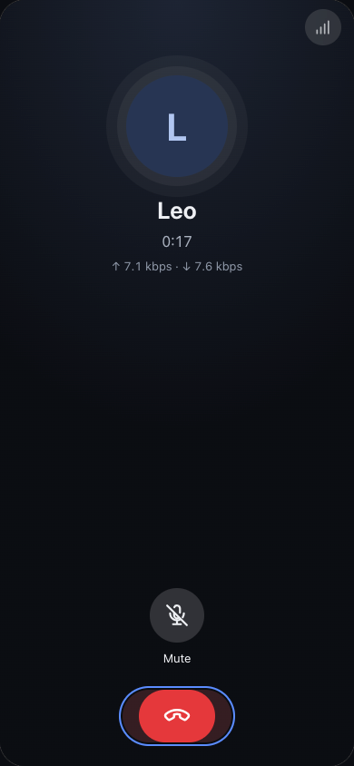
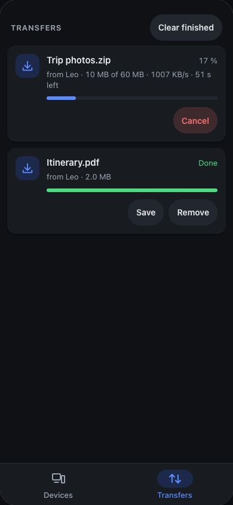
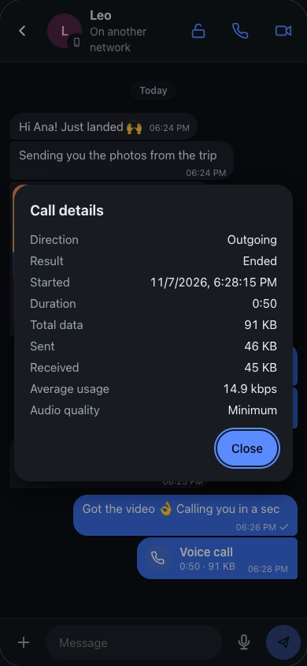
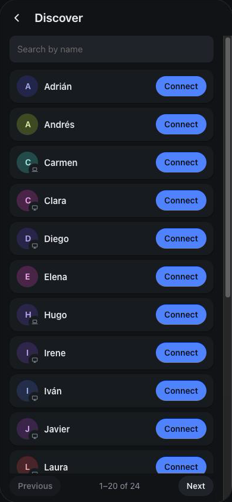

# Pasalo

[English](README.md) · **Español** · [Русский](README.ru.md)

**Pasa archivos, chatea y llama entre tus equipos, directo de uno a otro.** Sin cuentas, sin subir nada a ninguna nube, y con llamadas que aguantan aunque la conexión sea muy mala.

  
  
  
  

## Qué puedes hacer

- **Pasar archivos entre tu móvil y tu ordenador** en la misma wifi, sin cables y sin internet. Abres Pasalo en los dos y ya se ven.
- **Lo mismo con alguien en otra red**, en otra casa u otro país: os conectáis una vez y listo. Los archivos van directos de un equipo al otro, sin pasar por ninguna nube.
- **Llamar por voz o por vídeo** aunque solo tengas una rayita de cobertura.
- **Chatear** con fotos, notas de voz, fotos de «ver una vez» y chats privados que se borran al desconectaros.

Funciona en **Android, Mac, Windows y Linux**, y en el **iPhone** desde el navegador.

## Llamadas que aguantan con mala conexión

Las llamadas de Pasalo están hechas para redes malas: datos móviles con poca cobertura, wifis saturadas, conexiones lejanas.

- **Gastan muy poco.** Eliges la calidad (y se puede cambiar en plena llamada; el otro lado cambia también):

  | Calidad | Consumo | Una hora de llamada |
  |---|---|---|
  | Alta | ~42 kbps | ~19 MB |
  | Normal | ~26 kbps | ~12 MB |
  | Baja | ~19 kbps | ~9 MB |
  | **Mínima** | **~9 kbps** | **~4 MB** |

  En la captura, una llamada real en «Mínima»: unos 7 kbps en cada sentido.
- **No mandan nada en los silencios**: quien solo escucha gasta todavía menos.
- **Aguantan las pérdidas**: en los modos más bajos cada paquete lleva también el anterior, así que si se pierde uno, no se nota.
- **El vídeo se adapta solo**: si la red no da abasto, baja la calidad en vez de congelarse. Va de unos 40 a 300 kbps, y con el fondo desenfocado gasta un 30 % menos.
- **Sabes lo que gastaste**: cada llamada queda en el chat con su duración y sus datos.

## Pasar archivos, en casa o a distancia

- **En tu red, sin internet**: los equipos se encuentran solos. Arrastras archivos o carpetas encima de un equipo (en el ordenador) o pulsas enviar.
- **Entre redes distintas**: pulsas **Descubrir** en los dos, buscas al otro en la lista (tiene buscador), uno se lo pide al otro y el otro acepta. O compartes tu enlace. Pasalo busca el camino directo y, si las redes no lo permiten, pasa por un relay cifrado. No hay que abrir puertos ni configurar nada.
- **Si se corta, sigue donde iba**: se te va la wifi, cierras la app o se reinicia el otro equipo, y al volver continúa desde el último byte, no desde el principio.
- **Gasta lo justo**: lo que se puede comprimir se comprime (un registro de texto de 9,9 MB pasó como 2,2 MB). Las fotos y vídeos, que ya van comprimidos, se envían tal cual.
- **Archivos enormes y miles de archivos pequeños**, sin problema. Cada archivo se verifica al llegar.
- **Tú decides qué recibes**: cada envío llega como una solicitud que aceptas o rechazas.

## Privado por diseño

- **Sin cuentas**: tu equipo tiene su propia clave, que es su identidad; los chats y las llamadas van autenticados con ella.
- **Cifrado de un equipo a otro**: el chat, las llamadas y todo lo que va entre redes. (Los archivos que pasas dentro de tu propia red local van sin cifrar.)
- **El server solo os presenta** (para encontraros entre redes); por él no pasan archivos, mensajes ni llamadas.
- **Nada sale de tu red hasta que pulsas Descubrir.**
- **Fotos de «ver una vez»**: se borran al verlas y, en Android, Mac y Windows, no se pueden capturar mientras se ven.
- **Chats privados**: con el candado del chat, el historial se borra en los dos equipos al desconectaros.

## Descarga

Baja la última versión de [Releases](https://github.com/fresnohernandez99/pasalo/releases/latest):

| Equipo | Archivo |
|---|---|
| Android | `Pasalo-<versión>-android-universal.apk` (o `-arm64-v8a.apk` / `-armeabi-v7a.apk`, más ligeras) |
| Mac | `Pasalo_<versión>_universal.dmg` |
| Windows | `Pasalo_<versión>_x64-setup.exe` |
| Linux | `.AppImage`, `.deb` o `.rpm` |
| iPhone | Abre [pasalo-server.vercel.app/app](https://pasalo-server.vercel.app/app/) en Safari → Compartir → «Añadir a pantalla de inicio» |

Todavía no van firmadas por Apple ni Microsoft:

- **Mac:** la primera vez, clic derecho en Pasalo → **Abrir** → **Abrir**.
- **Windows:** si SmartScreen avisa, **Más información** → **Ejecutar de todas formas**.
- **Android:** permite instalar apps de este origen cuando te lo pregunte.

## Empezar en un minuto

1. Instala Pasalo en dos equipos.
2. **En la misma wifi**: ábrelo en los dos y aparecerán en **Equipos**. Toca uno para chatear o llamar, o el botón de enviar para mandarle archivos.
3. **En redes distintas**: los dos pulsáis **Descubrir**, uno toca **Conectar** junto al otro y el otro acepta.

## Más información

- [Documentación técnica](docs/technical.es.md): cómo funciona, protocolo, línea de comandos, compilar y publicar.
- [Pasalo en el navegador](web/README.md) (iPhone).
- [Server de conexión](server/README.md).

## Licencia

[MIT](LICENSE)
