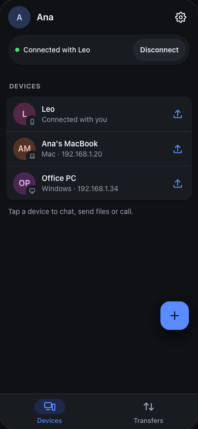
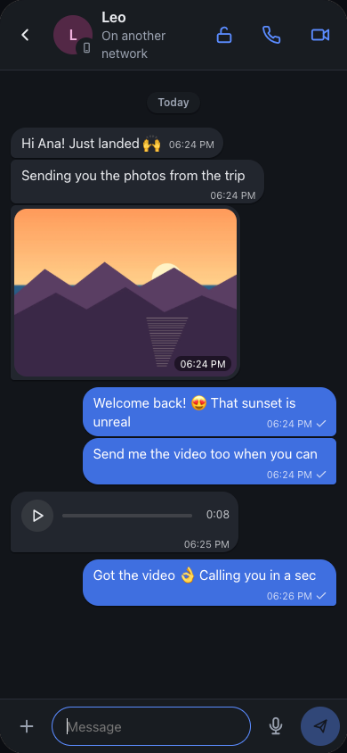
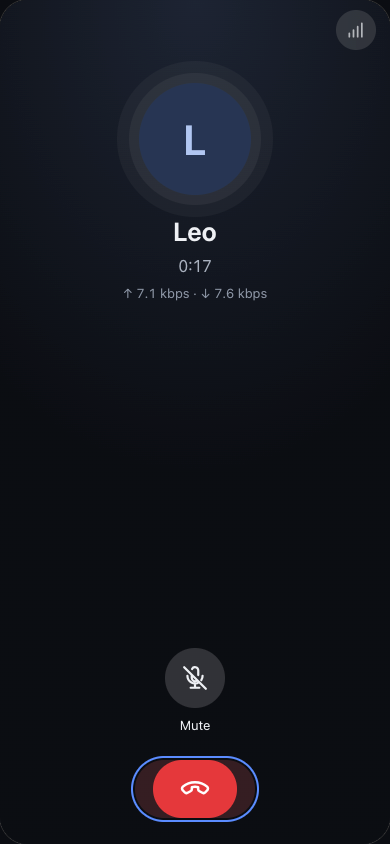
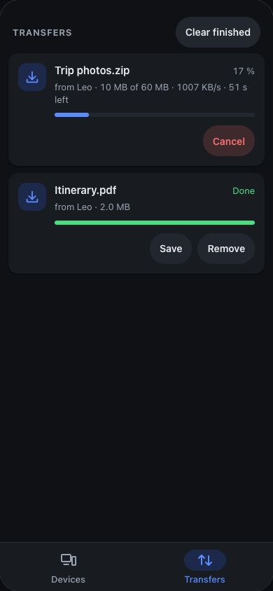
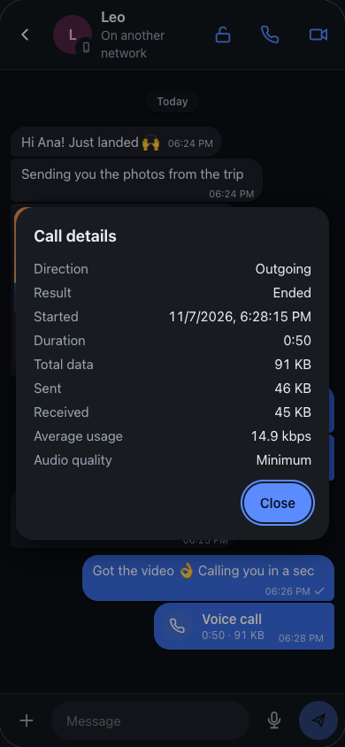
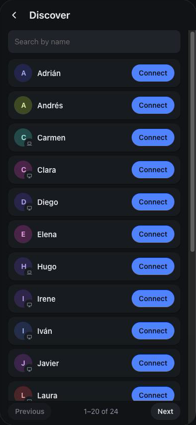

# Pasalo

**English** · [Español](README.es.md) · [Русский](README.ru.md)

**Send files, chat and call between your devices, straight from one to the other.** No accounts, nothing uploaded to any cloud, and calls that hold up even on a really bad connection.

  
  
  
  

## What you can do

- **Move files between your phone and your computer** on the same Wi-Fi, with no cables and no internet. Open Pasalo on both and they find each other.
- **Do the same with someone on another network**, in another home or another country: connect once and you're set. Files go straight from one device to the other, never through a cloud.
- **Make voice and video calls** even with a single bar of signal.
- **Chat** with photos, voice notes, view-once photos and private chats that are deleted when you disconnect.

Runs on **Android, Mac, Windows and Linux**, and on the **iPhone** in the browser.

## Calls that hold up on bad connections

Pasalo's calls are built for poor networks: mobile data with weak signal, crowded Wi-Fi, long distances.

- **They use very little data.** You pick the quality (and can change it mid-call; the other side follows):

  | Quality | Usage | One hour of calling |
  |---|---|---|
  | High | ~42 kbps | ~19 MB |
  | Normal | ~26 kbps | ~12 MB |
  | Low | ~19 kbps | ~9 MB |
  | **Minimum** | **~9 kbps** | **~4 MB** |

  The screenshot shows a real call on Minimum: about 7 kbps each way.
- **Nothing is sent during silence**, so whoever is just listening uses even less.
- **They survive packet loss**: in the lowest modes every packet also carries the previous one, so a lost packet goes unnoticed.
- **Video adapts on its own**: if the network can't keep up, quality drops instead of freezing. It ranges from about 40 to 300 kbps, and background blur uses 30 % less.
- **You know what you used**: every call is logged in the chat with its duration and data.

## Moving files, at home or far away

- **On your network, without internet**: devices find each other. Drag files or folders onto a device (on a computer) or tap send.
- **Across networks**: both tap **Discover**, find the other one in the list (there's a search box), one asks and the other accepts. Or share your link. Pasalo looks for a direct path and, if the networks don't allow one, goes through an encrypted relay. No ports to open, nothing to set up.
- **If it drops, it picks up where it left off**: lose Wi-Fi, close the app or restart the other device, and it continues from the last byte, not from the start.
- **Only what's needed goes over the wire**: compressible files are compressed (a 9.9 MB text log went as 2.2 MB). Photos and videos, already compressed, are sent as they are.
- **Huge files and thousands of small ones**, no problem. Every file is verified on arrival.
- **You decide what you receive**: every transfer arrives as a request you accept or decline.

## Private by design

- **No accounts**: your device has its own key, which is its identity; chats and calls are authenticated with it.
- **Encrypted from one device to the other**: chat, calls and everything that goes across networks. (Files you move within your own local network are not encrypted.)
- **The server only introduces you** (to find each other across networks); no files, messages or calls go through it.
- **Nothing leaves your network until you tap Discover.**
- **View-once photos**: deleted once seen, and on Android, Mac and Windows they can't be captured while open.
- **Private chats**: with the chat's lock, the history is deleted on both devices when you disconnect.

## Download

Get the latest version from [Releases](https://github.com/fresnohernandez99/pasalo/releases/latest):

| Device | File |
|---|---|
| Android | `Pasalo-<version>-android-universal.apk` (or `-arm64-v8a.apk` / `-armeabi-v7a.apk`, smaller) |
| Mac | `Pasalo_<version>_universal.dmg` |
| Windows | `Pasalo_<version>_x64-setup.exe` |
| Linux | `.AppImage`, `.deb` or `.rpm` |
| iPhone | Open [pasalo-server.vercel.app/app](https://pasalo-server.vercel.app/app/) in Safari → Share → "Add to Home Screen" |

They're not signed by Apple or Microsoft yet:

- **Mac:** the first time, right-click Pasalo → **Open** → **Open**.
- **Windows:** if SmartScreen warns you, **More info** → **Run anyway**.
- **Android:** allow installing apps from this source when asked.

## Get started in a minute

1. Install Pasalo on two devices.
2. **Same Wi-Fi**: open it on both and they show up under **Devices**. Tap one to chat or call, or its send button to send files.
3. **Different networks**: both tap **Discover**, one taps **Connect** next to the other, and the other accepts.

## More

- [Technical documentation](docs/technical.md): how it works, protocol, command line, building and releasing.
- [Pasalo in the browser](web/README.md) (iPhone).
- [Connection server](server/README.md).

## License

[MIT](LICENSE)
