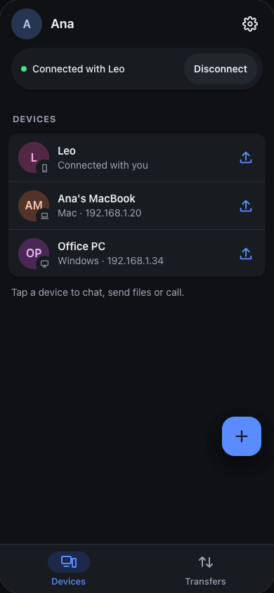
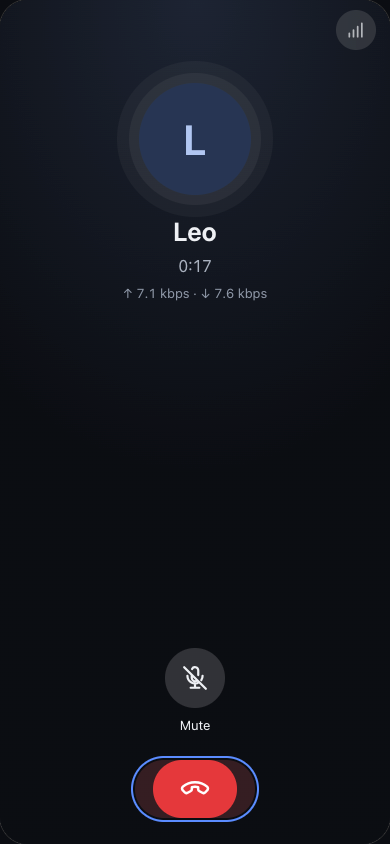
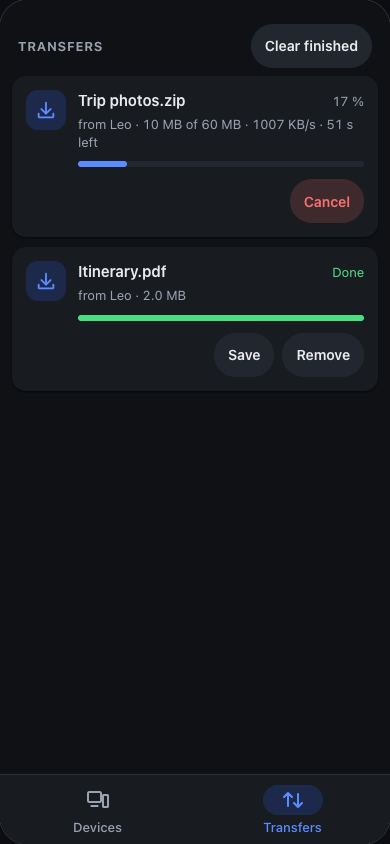
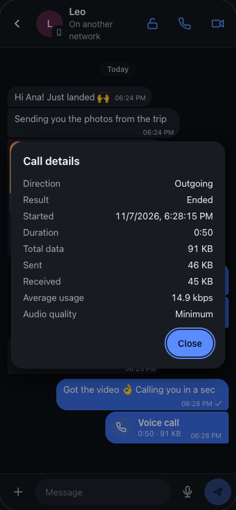
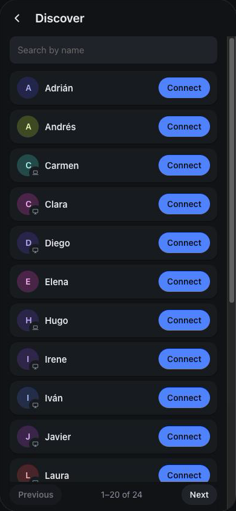

# Pasalo

[English](README.md) · [Español](README.es.md) · **Русский**

**Передавайте файлы, переписывайтесь и звоните между своими устройствами — напрямую, от одного к другому.** Без аккаунтов, без загрузки в облако, и со звонками, которые держатся даже при очень плохой связи.

  
  
  
  

## Что можно делать

- **Перекидывать файлы между телефоном и компьютером** в одной Wi-Fi, без проводов и без интернета. Откройте Pasalo на обоих — они найдут друг друга сами.
- **То же самое с человеком в другой сети**, в другом доме или другой стране: подключитесь один раз — и готово. Файлы идут напрямую, минуя любые облака.
- **Звонить голосом и по видео** даже при одной полоске сигнала.
- **Переписываться** с фото, голосовыми, фото на один просмотр и приватными чатами, которые удаляются при отключении.

Работает на **Android, Mac, Windows и Linux**, а на **iPhone** — в браузере.

## Звонки, которые держатся при плохой связи

Звонки Pasalo рассчитаны на плохие сети: мобильный интернет со слабым сигналом, перегруженный Wi-Fi, большие расстояния.

- **Тратят очень мало.** Качество выбираете вы (и можно сменить прямо во время звонка — собеседник переключится тоже):

  | Качество | Расход | Час разговора |
  |---|---|---|
  | Высокое | ~42 кбит/с | ~19 МБ |
  | Обычное | ~26 кбит/с | ~12 МБ |
  | Низкое | ~19 кбит/с | ~9 МБ |
  | **Минимальное** | **~9 кбит/с** | **~4 МБ** |

  На скриншоте — настоящий звонок на «Минимальном»: около 7 кбит/с в каждую сторону.
- **В тишине ничего не отправляется**, так что тот, кто только слушает, тратит ещё меньше.
- **Переживают потери**: в самых низких режимах каждый пакет несёт и предыдущий, поэтому потерю одного не слышно.
- **Видео подстраивается само**: если сеть не справляется, качество снижается, а не зависает картинка. От примерно 40 до 300 кбит/с, а с размытием фона — на 30 % меньше.
- **Видно, сколько потрачено**: каждый звонок остаётся в чате с длительностью и расходом.

## Файлы — дома или на расстоянии

- **В своей сети, без интернета**: устройства находят друг друга сами. Перетащите файлы или папки на устройство (на компьютере) или нажмите «отправить».
- **Между разными сетями**: оба нажимают **«Найти»**, находят друг друга в списке (есть поиск), один просит, другой принимает. Или поделитесь своей ссылкой. Pasalo ищет прямой путь, а если сети не позволяют — идёт через зашифрованный ретранслятор. Не нужно открывать порты и что-то настраивать.
- **Если оборвалось — продолжит с того же места**: пропал Wi-Fi, закрыли приложение, перезагрузилось другое устройство — передача продолжится с последнего байта, а не с начала.
- **По сети идёт только нужное**: то, что сжимается, сжимается (текстовый лог на 9,9 МБ прошёл как 2,2 МБ). Фото и видео, уже сжатые, отправляются как есть.
- **Огромные файлы и тысячи мелких** — без проблем. Каждый файл проверяется по приходу.
- **Вы решаете, что принимать**: каждая передача приходит как запрос, который можно принять или отклонить.

## Приватность по умолчанию

- **Без аккаунтов**: у устройства свой ключ — это его личность; чаты и звонки подтверждаются им.
- **Шифрование от устройства к устройству**: чат, звонки и всё, что идёт между сетями. (Файлы внутри вашей локальной сети передаются без шифрования.)
- **Сервер только знакомит** (чтобы найти друг друга между сетями); через него не идут ни файлы, ни сообщения, ни звонки.
- **Ничего не уходит из вашей сети, пока вы не нажмёте «Найти».**
- **Фото на один просмотр**: удаляются после просмотра, а на Android, Mac и Windows их нельзя заснять, пока они открыты.
- **Приватные чаты**: с замком в чате история удаляется на обоих устройствах при отключении.

## Скачать

Последняя версия — в [Releases](https://github.com/fresnohernandez99/pasalo/releases/latest):

| Устройство | Файл |
|---|---|
| Android | `Pasalo-<версия>-android-arm64-v8a.apk` |
| Mac | `Pasalo_<версия>_universal.dmg` |
| Windows | `Pasalo_<версия>_x64-setup.exe` |
| Linux | `.AppImage`, `.deb` или `.rpm` |
| iPhone | Откройте [pasalo-server.vercel.app/app](https://pasalo-server.vercel.app/app/) в Safari → «Поделиться» → «На экран „Домой“» |

Пока они не подписаны Apple и Microsoft:

- **Mac:** в первый раз — правый клик по Pasalo → **Открыть** → **Открыть**.
- **Windows:** если SmartScreen предупреждает — **Подробнее** → **Выполнить в любом случае**.
- **Android:** разрешите установку приложений из этого источника, когда спросит.

## Начать за минуту

1. Установите Pasalo на два устройства.
2. **В одной Wi-Fi**: откройте на обоих — они появятся в **Устройствах**. Нажмите на устройство, чтобы написать или позвонить, или на кнопку отправки, чтобы передать файлы.
3. **В разных сетях**: оба нажимают **«Найти»**, один нажимает **«Подключить»** рядом с другим, второй принимает.

## Подробнее

- [Техническая документация](docs/technical.ru.md): как это работает, протокол, командная строка, сборка и выпуск.
- [Pasalo в браузере](web/README.md) (iPhone).
- [Сервер подключения](server/README.md).

## Лицензия

[MIT](LICENSE)
